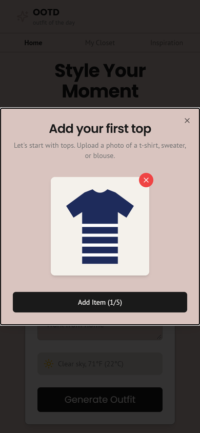
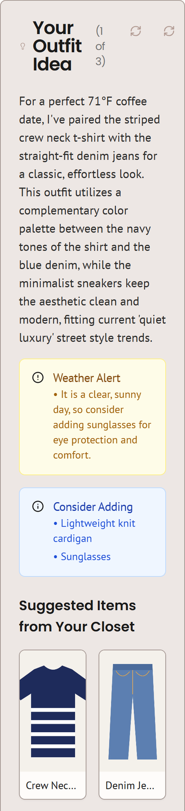
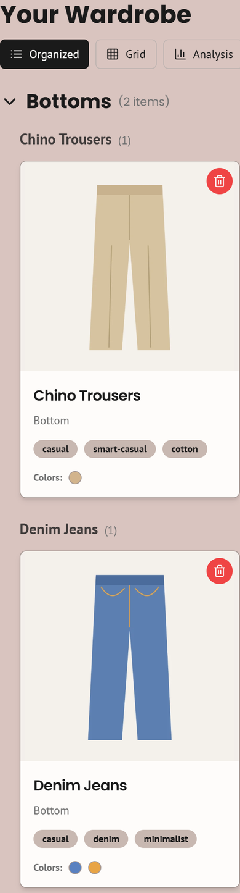
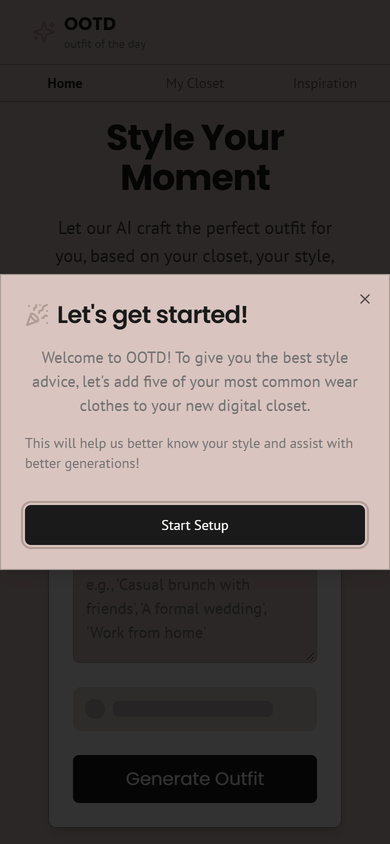
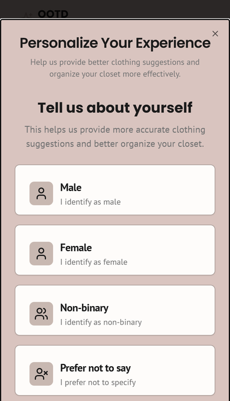
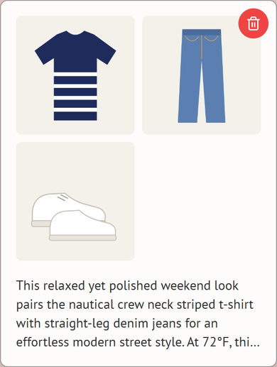
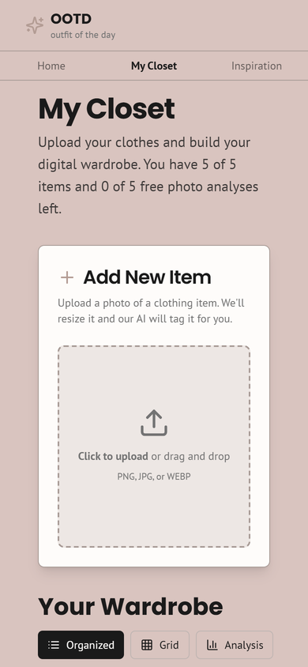
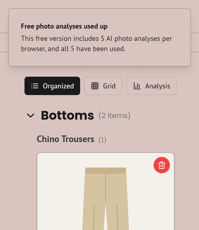

# OOTD: outfit of the day

**Photograph five things from your wardrobe, and OOTD suggests what to wear today, matched to the weather and the occasion, using only clothes you own.**

**Open the app:** https://ootdt11.netlify.app (any phone or computer browser, no sign-up)

Started at LaunchX (Boston University) by Team 11 · Maintained by Yu Chen (Roger)

<p>
  
  
  
</p>

*All screenshots are from the current version on a phone-sized screen. The "clothes" are simple drawings used as test photos.*

---

## Contents

- [Quick start](#quick-start)
- [Pages and features](#pages-and-features)
- [What the AI does](#what-the-ai-does)
- [Free version limits](#free-version-limits)
- [Privacy in short](#privacy-in-short)
- [Troubleshooting](#troubleshooting)
- [For developers](#for-developers)
- [Team, AI use and licence](#team-ai-use-and-licence)

## Quick start

| Step | What to do | |
|---|---|---|
| 1 | Open https://ootdt11.netlify.app. A welcome screen appears the first time. Tap **Start Setup**. |  |
| 2 | Choose how clothing types should be named: Male, Female, Non-binary or Prefer not to say. Tap **Continue**. |  |
| 3 | Add **5 photos: 2 tops, 2 bottoms and 1 pair of shoes**. For each one, tap the box, pick a photo, then tap **Add Item**. The AI reads each photo in a few seconds. |  |
| 4 | Tap **Start Generating**. Type an occasion if you like (for example "coffee with friends"), allow location or type a city for the weather, then tap **Generate Outfit**. |  |
| 5 | Like the outfit? Tap ♡ to save it to **Inspiration**. |  |

**Tips for good photos:** one item per photo, laid flat or on a hanger, on a plain background in good light. Photograph clothes only, not people.

## Pages and features

### Home: create your outfit
- **Occasion box** (optional): describe what you are dressing for.
- **Weather line:** the current weather where you are. If location is blocked, tap **Enter location manually** and type a city.
- **"Not from my closet" switch:** general outfit ideas instead of ones built from your closet.
- **Generate Outfit:** the result card shows
  - a short description of the outfit and why its colours work together;
  - a **weather alert** when the weather calls for something you don't have;
  - **Consider adding:** everyday items that would complete the look;
  - **Suggested items from your closet**, with your own photos.
- Buttons on the result card: the first ↻ shows the next option ("1 of 3"), the second ↻ asks for new ideas, and ♡ saves the outfit.

### My Closet



- The top line shows how many items you have and how many **free photo analyses** are left.
- **Add New Item:** upload one more photo (see the [limits](#free-version-limits)).
- Three views:
  - **Organized:** items grouped by category and type, each with the AI's tags and colour swatches.
  - **Grid:** all items as cards.
  - **Analysis:** compares your closet with a list of common clothing types for the option you chose in set-up. This view uses fixed rules, not AI.
- 🗑 removes an item.

### Inspiration
Outfits you saved with ♡. 🗑 removes one.

### Privacy
What is stored and what is sent to the AI: https://ootdt11.netlify.app/privacy

## What the AI does

OOTD uses Google's Gemini models, called only from the app's server.

| Task | What is sent | What comes back |
|---|---|---|
| Tagging a photo | The photo, shrunk to at most 1024 px | Category, specific type (e.g. "crew neck striped t-shirt"), style tags, main colours as hex codes, and any pattern |
| Building an outfit | Text descriptions of your items (not the photos), your occasion and the current weather | The outfit (items picked from your closet), why it works, alternatives, a weather alert and items worth adding |

## Free version limits



- **5 free AI photo analyses per browser.** Each photo you add is analysed once. After five, this browser can't add more photos, even if you delete items. Requests that fail don't count. The count is kept in your browser, so clearing site data resets it. The limit of five has been part of OOTD since its first version. Set in `FREE_PHOTO_ANALYSES`, [`src/lib/free-analyses.ts`](src/lib/free-analyses.ts).
- **5 closet items.** Set-up asks for exactly five, outfits need at least five, and the closet holds at most five.
- **Outfit suggestions are not capped per browser.** All visitors share the AI's free daily limit; when it is reached, the app says so.
- **Photos:** PNG, JPG or WEBP; up to about 1.5 MB after the app shrinks them.
- **Speed:** tagging usually takes a few seconds, but can take up to about 30 seconds when the AI is busy.
- **One browser, no account:** your closet lives in the browser you used and does not follow you to another device.

## Privacy in short

- No accounts and no database: your photos, their tags, your saved outfits and your free-analysis count stay in your own browser.
- Each photo is sent to Google's Gemini API to be tagged. The app uses Gemini's free tier, under which Google may use what is sent to improve its products, so please photograph clothes only.
- Your location (or the city you type) is used only to look up the weather from Open-Meteo, and is not stored.
- To delete everything, remove items in the app or clear this site's data in your browser.

Full details: [privacy page](https://ootdt11.netlify.app/privacy).

## Troubleshooting

| You see | What it means |
|---|---|
| "The AI service is busy right now" | The free AI is overloaded for a moment. Wait a little and try again; the failed attempt does not use a free analysis. |
| "The app has reached its free AI usage limit for now" | All visitors share a daily AI limit. Try again later. |
| "Free photo analyses used up" | This browser has used its five free photo analyses. |
| "Location access denied" on the weather line | Tap **Enter location manually** and type a city. |
| "Invalid file type" | Use a PNG, JPG or WEBP photo. |

## For developers

### How it works

```
photo ──► browser: check type (PNG/JPG/WEBP), shrink to ≤1024 px WEBP, check free analyses left
      ──► server action tagClothingItem ──► Gemini (image + prompt) ──► JSON tags
      ──► saved in the browser's localStorage (no database)

"Generate Outfit" ──► server action generateOutfitIdea
      ├─ weather: Open-Meteo (free, no key)
      └─ Gemini (closet as text + occasion + weather) ──► JSON outfit ──► shown on the page
```

- **The API key stays on the server.** Gemini is only called from Next.js server actions ([`src/ai/`](src/ai/)), so visitors' browsers never see the key. The key is on Gemini's free tier, with no billing attached.
- **Busy models fall through.** The app tries `gemini-3.5-flash-lite` first, moves to the next model if one is busy, and gives up on a model after 12 seconds ([`src/ai/gemini.ts`](src/ai/gemini.ts)).
- **Errors are explained.** If the AI fails, the page says why (busy, usage limit reached, key or region rejected) instead of saving a blank item.

### Tech stack

| Part | Used |
|---|---|
| Framework | Next.js 14.2 (App Router, server actions), React 18, TypeScript |
| UI | Tailwind CSS, shadcn/ui (Radix) components |
| AI | Google Gemini API via `@google/generative-ai`; default model `gemini-3.5-flash-lite` |
| Weather | Open-Meteo forecast and geocoding APIs |
| Hosting | Netlify (Next.js runtime), deployed from this repo; config in [`netlify.toml`](netlify.toml) |

### Run it locally

You need Node.js 20 or later and a Gemini API key from [Google AI Studio](https://aistudio.google.com/apikey).

```bash
git clone https://github.com/Rogercy-whoop/ootd.git
cd ootd
npm install
echo GEMINI_API_KEY=your-key-here > .env.local
npm run dev
```

Then open http://localhost:3000. In mainland China, Gemini answers "User location is not supported", so the dev server itself must go through a VPN (system-wide or TUN mode, not just the browser).

To deploy your own copy on Netlify, import the repo and set `GEMINI_API_KEY` as a secret environment variable. `netlify.toml` covers the rest.

### Known gaps

- Switched off in this version: email login with cloud sync (Firebase Auth and Firestore, `NEXT_PUBLIC_ENABLE_LOGIN`), and background removal (Replicate, `REPLICATE_API_TOKEN`).
- No automated tests yet, and `next.config.js` skips type checks during builds; `tsc` reports 9 errors, all in the switched-off login code.
- Not tested from mainland China without a VPN.

## Team, AI use and licence

- Started at LaunchX (Boston University) by **Team 11**: Roger (team leader and technical lead), Eileen and Quinten. Roles: [ROLES.md](ROLES.md).
- How AI coding tools were used to build OOTD, and which decisions were Roger's: [AI-USE.md](AI-USE.md).
- Maintained by Yu Chen (Roger).
- Licence: [MIT](LICENSE).
