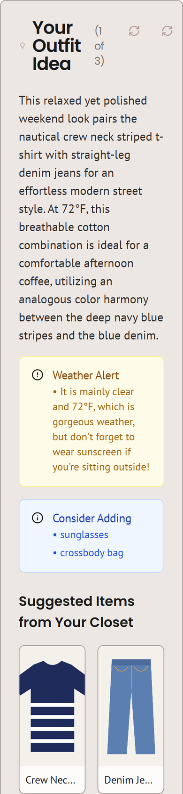
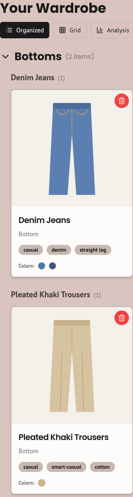

# OOTD: outfit ideas from clothes you already own

**Photograph five things from your wardrobe, and the app suggests what to wear today, matched to the weather and the occasion, using only clothes you own.**

**Live:** https://ootdt11.netlify.app · Built by Team 11 at LaunchX (Boston University), summer 2025 · Launched publicly 13 October 2026

Yu Chen (Roger) · Grade 12 · Suzhou, China

<p>
  
  
  
</p>

*From left: set-up, an outfit for "coffee with friends on a weekend afternoon", and the closet with the tags and colours the AI read from each photo. Screenshots from the live site on a phone-sized screen; the "clothes" are simple drawings I used as test photos. On a computer it looks like [this](docs/screenshots/desktop-closet.png).*

---

## What it is

OOTD ("outfit of the day") was Team 11's company at LaunchX, an entrepreneurship programme at Boston University, in summer 2025. It only works with clothes you already own: you photograph them once, and it suggests combinations from them. I was the team leader and technical lead (see [ROLES.md](ROLES.md)).

The first version was built in July 2025 by directing AI coding tools (Firebase Studio's app builder and Cursor), and it never went online. In October 2026 I relaunched it, working with Claude Code: we fixed the AI calls, cut what didn't work and put it online. [AI-USE.md](AI-USE.md) says exactly which parts AI wrote.

## What it does today

| Step | What happens | Where it runs |
|---|---|---|
| 1. Set-up | You choose how clothes should be labelled (male, female, non-binary or prefer not to say), then add **5 photos: 2 tops, 2 bottoms and 1 pair of shoes**. | Your browser |
| 2. Tagging | Each photo is shrunk to at most 1024 px and sent to Google's Gemini AI, which returns the category, the specific type (e.g. "crew neck striped t-shirt"), style tags, main colours as hex codes and any pattern. | Server → Gemini |
| 3. Outfit | You can type an occasion. The app looks up the current weather (from your location or a city you type), then Gemini picks items from your closet by ID, explains the colour choice, and adds 2–3 alternatives, weather warnings and items worth adding. Only text descriptions of your clothes are sent, not the photos. | Server → Gemini |
| 4. Keep | Save outfits you like to **Inspiration**. **My Closet** sorts items by category and has an **Analysis** view that compares your closet with a fixed list of clothing types (rules, not AI). | Your browser |

## How it works

```
photo ──► browser: check type (PNG/JPG/WEBP), shrink to ≤1024 px WEBP
      ──► server action tagClothingItem ──► Gemini (image + prompt) ──► JSON tags
      ──► saved in the browser's localStorage (no database)

"Generate Outfit" ──► server action generateOutfitIdea
      ├─ weather: Open-Meteo (free, no key)
      └─ Gemini (closet as text + occasion + weather) ──► JSON outfit ──► shown on the page
```

- **The API key stays on the server.** Gemini is only called from Next.js server actions ([`src/ai/`](src/ai/)), so visitors' browsers never see the key.
- **Busy models fall through.** On the free tier the larger Gemini models often answered "503 high demand" (one took over 3 minutes), while `gemini-3.5-flash-lite` answered in about a second. The app tries flash-lite first, moves to the next model if one is busy, and gives up after 12 seconds ([`src/ai/gemini.ts`](src/ai/gemini.ts)).
- **Errors are explained.** If the AI fails, the page says why (busy, usage limit reached, key or region rejected) instead of saving a blank "unknown" item.
- **Measured on the live site** (13 October 2026, two full runs in a phone-sized browser with five test images each): tagging took 5.4–12.0 s per photo, and an outfit took 5.3–6.8 s.

## Limits of this version

Every number here comes from the code or from the live tests above.

- **5 closet items.** Set-up asks for exactly 5, outfits need at least 5, and the closet holds at most 5 (`MAX_FREE_CLOSET_ITEMS` in [`src/app/closet/page.tsx`](src/app/closet/page.tsx)). To add a new item you remove one.
- **No accounts.** Your closet lives only in the browser you used. Clearing site data deletes it.
- **No per-visitor cap on AI use.** The only limit is the Gemini free tier. When it is reached, the app says so and asks you to try later. It cannot run up a bill: the key's Google project has no billing attached.
- **Images:** PNG, JPG or WEBP only. The server refuses anything over about 1.5 MB after shrinking.
- **Privacy:** the free tier lets Google use what is sent to improve its products, so the [privacy page](https://ootdt11.netlify.app/privacy) asks people to photograph clothes only, not themselves.
- **Speed:** each photo takes several seconds to tag (up to 12 s in tests), and a busy moment at Gemini can make an upload fail. If that happens, try again.
- **Mainland China:** Gemini refuses requests from mainland China. The live site calls Gemini from Netlify's servers abroad, but I have not tested opening the site from mainland China without a VPN.
- **Built but switched off:** email login with cloud sync (Firebase Auth and Firestore, `NEXT_PUBLIC_ENABLE_LOGIN`), and background removal (Replicate, `REPLICATE_API_TOKEN`). Background removal uploaded photos to publicly readable storage, so it stays off.
- **Removed before launch:** the Stripe "Premium" payment links (paying unlocked nothing, because the step that grants Premium was never built), an unfinished 3D outfit viewer, and developer debug pages.
- **Code debt:** there are no automated tests, and `next.config.js` skips type checks during builds. `tsc` reports 9 errors, all in the switched-off login code.

## Tech stack

| Part | Used |
|---|---|
| Framework | Next.js 14.2 (App Router, server actions), React 18, TypeScript |
| UI | Tailwind CSS, shadcn/ui (Radix) components |
| AI | Google Gemini API via `@google/generative-ai`; default model `gemini-3.5-flash-lite` |
| Weather | Open-Meteo forecast and geocoding APIs |
| Hosting | Netlify (Next.js runtime), deployed from this repo; config in [`netlify.toml`](netlify.toml) |
| First version | Firebase Studio (Google's AI app builder) and Cursor; Firebase Studio's first plan is in [`docs/blueprint.md`](docs/blueprint.md) |

## Run it locally

You need Node.js 20 or later and a Gemini API key from [Google AI Studio](https://aistudio.google.com/apikey).

```bash
git clone https://github.com/Rogercy-whoop/ootd.git
cd ootd
npm install
echo GEMINI_API_KEY=your-key-here > .env.local
npm run dev
```

Then open http://localhost:3000. In mainland China, Gemini answers "User location is not supported", so the dev server itself must go through a VPN (system-wide or TUN mode, not just the browser).

To deploy your own copy on Netlify, import the repo and set `GEMINI_API_KEY` as a secret environment variable. `netlify.toml` covers the rest.

## History

| When | What |
|---|---|
| 4–11 July 2025 | First version built with Firebase Studio and Cursor during LaunchX: 45 commits (`672c7ff` → `c4bff4d`). The app was not deployed; its Firebase Hosting address still shows Firebase's placeholder page, uploaded 9 July 2025. |
| 10–13 October 2026 | Relaunch, done with Claude Code under my direction (`f6cbcb7` onwards): fixed the AI calls, made the app guest-only, removed payments and unfinished features, added a privacy page and phone layout, and deployed it on Netlify. |

## Team and AI use

- [ROLES.md](ROLES.md): who did what in Team 11 at LaunchX.
- [AI-USE.md](AI-USE.md): what Firebase Studio, Cursor and Claude Code wrote, and which decisions were mine.

## Licence

[MIT](LICENSE).
